# Architecture d'Open Mosaik

Media center de salon pour Linux, piloté depuis le navigateur d'un smartphone. Ce document répond au sujet `docs/EpiKodi_PGE3.pdf` (rubrique « Architecture » de la documentation technique). Il décrit les composants, les flux de données et les choix de stack.

> **Statut : proposition, novembre 2026.** Rien n'est encore implémenté. Le dépôt ne contient que le scaffold Tauri (voir [§15](#15-écarts-avec-le-scaffold-actuel)). Une hypothèse bloquante reste à valider : la superposition de l'interface sur la vidéo ([§5.2](#52-affichage-de-la-vidéo--le-risque-n1)).

## 1. Les contraintes qui structurent tout

Sept exigences déterminent l'architecture : C1 à C6 viennent du sujet, C7 est un choix du binôme. Le reste en découle.

| # | Exigence du sujet | Conséquence |
|---|---|---|
| C1 | Lecture par une vraie bibliothèque, « jamais par le lecteur intégré […] Electron, Tauri » | libmpv côté Rust, composée nativement avec le webview. Aucune balise `<video>` ni `<audio>`. |
| C2 | Extensions dans un processus séparé, permissions appliquées par le produit, système conçu par le groupe | Un processus hôte par extension. Toute capacité passe par un courtier situé dans le processus principal. |
| C3 | Installation et désinstallation sans redémarrer ni recompiler | Extensions interprétées et chargées à l'exécution. Pas de plugin Tauri ni de `dlopen`. |
| C4 | Télécommande : page web servie par le media center, sans installation | Serveur HTTP/WebSocket embarqué, indépendant de l'IPC Tauri, branché sur les mêmes services. |
| C5 | Tests sans réseau, sur une seule commande, intégrés à la CI | Cœur métier sans dépendance à Tauri, GTK ou libmpv. Toute entrée-sortie passe par un port injecté. |
| C6 | Un partage lent ou absent ne doit pas dégrader la médiathèque | Aucun appel réseau sur un chemin de lecture de l'interface. Une source injoignable n'est jamais interprétée comme « fichiers supprimés ». |
| C7 | Tout est configurable depuis les paramètres de l'application : clé TMDB, adresse de la télécommande, sources SMB, etc. | Réglages typés, appliqués à chaud, sans fichier à éditer ni redémarrage ([§9](#9-configuration)). |

## 2. Vue d'ensemble

Le processus principal contient toute la logique. Deux transports, l'IPC Tauri pour la télé et HTTP/WebSocket pour le téléphone, appellent **les mêmes instances de services**.

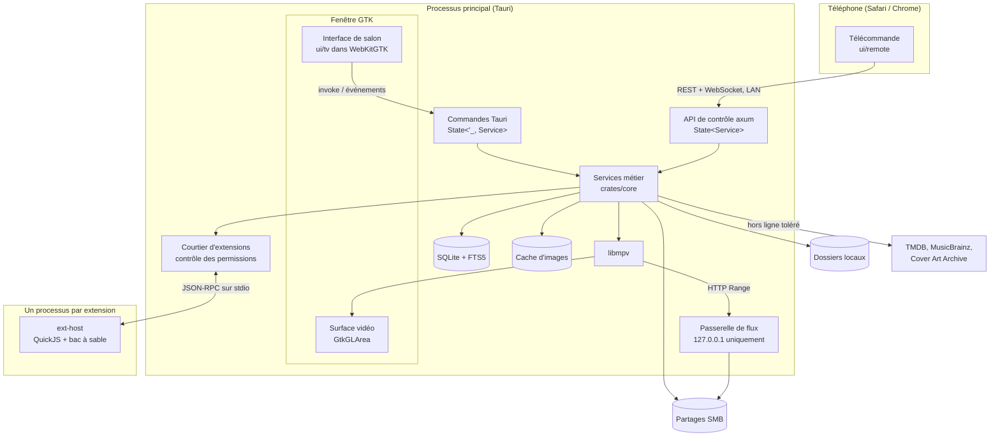

### Découpage du dépôt

La séparation en crates rend la règle de dépendance vérifiable par le compilateur : `core` ne peut pas importer Tauri, puisqu'il ne figure pas dans son `Cargo.toml`.

```text
.
├── Cargo.toml             # workspace
├── crates/
│   ├── core/              # domaine, services, ports. Aucune dépendance native.
│   ├── infra/             # SQLite, SMB, TMDB, MusicBrainz, secrets, images
│   ├── player-mpv/        # PlayerEngine via libmpv
│   ├── remote-api/        # routeur axum, passerelle de flux
│   ├── ext-host/          # binaire : QuickJS + bac à sable
│   └── ext-protocol/      # messages JSON-RPC, manifeste, permissions
├── src-tauri/             # racine de composition, commandes, surface GTK
├── ui/
│   ├── tv/                # React, interface 10 pieds
│   ├── remote/            # React, télécommande (embarquée dans le binaire)
│   └── shared/            # types générés, client d'API, composants, feuille Tailwind commune
├── extensions/            # catalogue domaine public, widget météo, cas hostiles
├── themes/default/        # thème par défaut + JSON Schema
├── scripts/               # installation de la médiathèque de démo
└── docs/                  # utilisateur, technique, ADR, guide d'extensions
```

Sens des dépendances : `src-tauri → {infra, player-mpv, remote-api} → core`. `core` ne dépend d'aucune autre crate applicative, à part `ext-protocol` qui ne contient que des types.

## 3. Injection de dépendances

### Le principe

Trois règles :

1. **Injection par constructeur.** Un service reçoit ses dépendances dans `new()`. Il ne connaît ni `AppHandle` ni `State`.
2. **`State` s'arrête à la frontière.** Seules les commandes Tauri résolvent les services par `State<'_, T>`. Les handlers axum font de même avec l'extracteur `State<T>` d'axum.
3. **Une seule racine de composition.** `src-tauri/src/bootstrap.rs` est le seul fichier qui connaît à la fois les services et les implémentations concrètes.

Il y a deux niveaux d'abstraction :

| | Service | Port |
|---|---|---|
| **Nature** | `struct` concrète, logique métier | `trait`, accès au monde extérieur |
| **Exemples** | `LibraryService`, `PlaybackService` | `MediaRepository`, `PlayerEngine`, `SourceProvider` |
| **Injecté sous la forme** | Valeur `Clone` | `Arc<dyn Port>` |
| **En test** | Le vrai service | Un faux en mémoire |

Les services restent concrets, car un trait par service n'apporterait rien : on ne remplace que les bords du système.

### Le service comme poignée clonable

`State<'_, T>` recherche par type, et `T` doit être `Send + Sync + 'static`. En rendant chaque service peu coûteux à cloner, on obtient exactement `State<'_, LibraryService>`, sans `Arc<...>` dans les signatures. La même instance logique peut alors être partagée avec axum et les tâches de fond.

```rust
// crates/core/src/library/service.rs
#[derive(Clone)]
pub struct LibraryService {
    media: Arc<dyn MediaRepository>,
    progress: Arc<dyn ProgressRepository>,
    events: EventBus,
}

impl LibraryService {
    pub fn new(
        media: Arc<dyn MediaRepository>,
        progress: Arc<dyn ProgressRepository>,
        events: EventBus,
    ) -> Self {
        Self { media, progress, events }
    }

    pub async fn list_movies(&self, query: MovieQuery) -> Result<Page<MovieDto>, AppError> {
        self.media.list_movies(query).await
    }
}
```

```rust
// src-tauri/src/commands/library.rs : traduction uniquement, aucune logique
#[tauri::command]
pub async fn list_movies(
    library: State<'_, LibraryService>,
    query: MovieQuery,
) -> Result<Page<MovieDto>, AppError> {
    library.list_movies(query).await
}
```

```rust
// crates/remote-api/src/library.rs : même service, autre transport
async fn list_movies(
    State(library): State<LibraryService>,
    _device: PairedDevice,
    Query(query): Query<MovieQuery>,
) -> Result<Json<Page<MovieDto>>, ApiError> {
    Ok(Json(library.list_movies(query).await?))
}
```

Un état mutable, s'il en faut, reste privé au service (`Arc<RwLock<_>>`, `watch`). Il n'y a donc aucun `Mutex` dans les signatures de commandes.

### La racine de composition

```rust
// src-tauri/src/bootstrap.rs
pub struct Services {
    pub sources: SourceService,
    pub scan: ScanService,
    pub library: LibraryService,
    pub metadata: MetadataService,
    pub playback: PlaybackService,
    pub extensions: ExtensionService,
    pub pairing: PairingService,
    pub input: InputService,
    pub settings: SettingsService,
    pub remote: RemoteServerService,
}

pub fn register(app: &App, services: Services) {
    // Sans `..` : ajouter un champ sans l'enregistrer casse la compilation.
    let Services { sources, scan, library, metadata, playback,
                   extensions, pairing, input, settings, remote } = services;
    app.manage(sources);
    app.manage(scan);
    // ...
}
```

### Pièges de `State` à traiter dès le départ

| Comportement de Tauri | Parade |
|---|---|
| Un `State<'_, T>` non enregistré n'est détecté qu'à l'appel de la commande. | Déstructuration exhaustive ci-dessus, plus un test de démarrage qui appelle `try_state` pour chaque service. |
| La résolution se fait par type : deux valeurs du même type ne cohabitent pas. | Un type par service. Pas de `manage` direct d'un `Arc<dyn Port>`. Les ports restent internes aux services. |
| Une commande `async` prenant `State<'_, T>` doit renvoyer un `Result` ([doc](https://tauri.app/develop/state-management/)). | Toutes les commandes renvoient `Result<_, AppError>`. |
| Une commande peut être appelée dès que la page est chargée. | `create: false` sur la fenêtre : elle est créée dans `setup`, **après** `register`. |

### Graphe des services

Le graphe doit rester acyclique, ce que garantit la construction dans `bootstrap.rs` : un cycle ne peut tout simplement pas s'y écrire. Quand un service doit réagir à un autre sans en dépendre, il passe par l'`EventBus`.

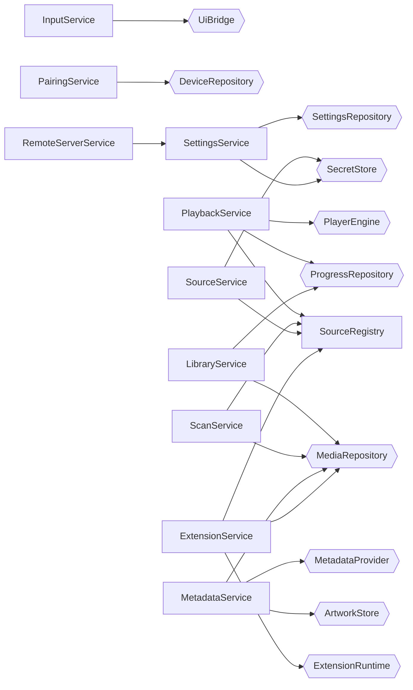

Les autres services ne dépendent pas de `SettingsService` : ils reçoivent une vue en lecture seule (§9), omise ici pour la lisibilité.

Hexagones : ports. `SourceRegistry` découple la médiathèque des extensions : une extension y inscrit un `SourceProvider`, et le scan ne sait pas d'où il vient.

### Ports

| Port | Implémentation réelle | Faux pour les tests |
|---|---|---|
| `MediaRepository`, `SourceRepository`, `ProgressRepository`, `DeviceRepository`, `ExtensionRepository`, `SettingsRepository` | SQLite via `sqlx` | SQLite `:memory:` |
| `SourceProvider` | Dossier local, SMB, extension | Arborescence en mémoire avec pannes programmables |
| `MetadataProvider` | TMDB, MusicBrainz + Cover Art Archive | Réponses enregistrées |
| `ArtworkStore` | Fichiers dans le répertoire de données | En mémoire |
| `SecretStore` | Secret Service (`keyring`) | En mémoire |
| `PlayerEngine` | libmpv | Moteur scripté, émet des événements à la demande |
| `ExtensionRuntime` | Processus `ext-host` | Hôte en mémoire |
| `UiBridge` | `AppHandle::emit` | Enregistreur |
| `Clock` | Horloge système | Horloge manuelle (expiration des codes, reprise) |

Les ports utilisés en `dyn` et comportant des méthodes `async` passent par `async-trait`.

### Modèle d'exécution

| Fil | Rôle | Règle absolue |
|---|---|---|
| Principal GTK | Boucle GTK, rendu GL de mpv | Aucun appel bloquant, en particulier aucun appel libmpv hors rendu |
| Runtime Tokio | Services, axum, I/O asynchrones | Pas de calcul long ni d'appel synchrone |
| Fil `mpv` dédié | Commandes vers mpv, boucle d'événements | Seul à parler à l'API cliente de mpv |
| Pool `spawn_blocking` | Lecture de tags audio, parcours de disque local | Taille bornée par sémaphore |
| Processus `ext-host` | Une extension | Communique uniquement via stdio |

## 4. Médiathèque

### Sources

Le port `SourceProvider` unifie dossiers locaux, SMB et catalogues d'extensions :

```rust
#[async_trait]
pub trait SourceProvider: Send + Sync {
    async fn health(&self) -> SourceHealth;
    fn enumerate(&self) -> BoxStream<'_, Result<SourceEntry, SourceError>>;
    async fn locate(&self, entry: &EntryRef) -> Result<PlaybackLocator, SourceError>;
    async fn read_at(&self, entry: &EntryRef, offset: u64, buf: &mut [u8]) -> Result<usize, SourceError>;
}

pub enum PlaybackLocator {
    LocalPath(PathBuf),   // dossier local : mpv lit directement
    Gateway(EntryRef),    // SMB : mpv lit via la passerelle de flux
    RemoteUrl(Url),       // extension : domaine vérifié par le courtier
}
```

`SourceEntry` porte un identifiant stable, une taille, une date de modification et des indices de métadonnées facultatifs. Une extension peut ainsi fournir directement titre et affiche, sans passer par la reconnaissance de nom de fichier.

**Santé d'une source.** Un moniteur de fond maintient `Online | Slow | Unreachable`. Chaque appel distant a un délai maximal. Après plusieurs échecs, le coupe-circuit rend la source `Unreachable` immédiatement, sans nouvelle attente. L'état est diffusé à l'interface, qui l'affiche en clair et grise les médias concernés. Les données de la médiathèque viennent toujours de SQLite (C6).

**Identifiants SMB.** `sources.credential_ref` ne contient qu'une référence vers le Secret Service. Si aucun trousseau n'est disponible, l'ajout d'une source authentifiée échoue avec un message explicite plutôt que de stocker le mot de passe en clair. Un partage invité reste possible.

### Algorithme de scan

Le scan se fait en deux temps, pour que la découverte des fichiers ne dépende ni d'internet ni de l'enrichissement.

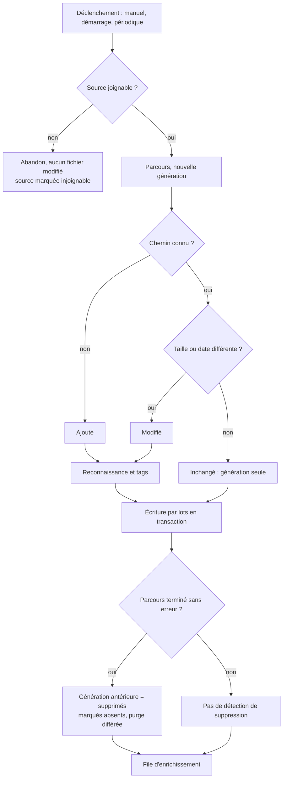

Trois garde-fous :

- **Un parcours interrompu ne supprime rien.** Sans cette règle, une coupure réseau en plein scan viderait la médiathèque.
- **Suppression en deux temps.** `missing_since` conserve la progression et les favoris pendant une période de grâce, si un disque revient plus tard.
- **Corrections protégées.** `match_locked` empêche un nouveau scan d'écraser une correction manuelle.

La performance exigée (1 000 fichiers) est mesurée par phase sur une arborescence générée : parcours, reconnaissance et écriture séparément, en local et sur le Samba de test. Les résultats vont dans la documentation d'exploitation.

### Reconnaissance

Fonctions pures dans `core::recognition`, sans I/O, testées sur un corpus de cas difficiles en table (`recognition/fixtures/*.yaml`) :

1. Normalisation : séparateurs, retrait des marqueurs techniques (`1080p`, `x265`, groupes).
2. Épisodes : `S01E02`, `1x02`, `Saison 1/Episode 2` (le dossier parent sert d'indice).
3. Films : titre et année, `Titre (2004)`, `Titre.2004.mkv`.
4. Musique : tags via `lofty` en priorité, puis arborescence `Artiste/Album/`.
5. Résultat : champs extraits et **score de confiance**. Sous le seuil, le média passe à « à vérifier ».

### Enrichissement et cache

- File persistante en base : elle survit à un redémarrage et se relance au retour du réseau.
- Limitation par fournisseur (MusicBrainz : 1 requête/s et `User-Agent` identifiant, selon ses conditions), plus une reprise avec délai croissant.
- Recherche, classement des candidats, puis application au-dessus du seuil de confiance. Sinon, les candidats sont conservés pour la **correction manuelle**, qui ne relance pas de requête.
- Images redimensionnées dans `$XDG_DATA_HOME/open-mosaik/artwork/`, nommées par empreinte. On utilise le répertoire de données plutôt que le cache XDG, qui peut être purgé, car la médiathèque doit rester consultable hors ligne.
- Servies à la télé par un schéma d'URI Tauri (`artwork://`), au téléphone par `GET /api/v1/artwork/{id}` authentifié.
- L'attribution TMDB et MusicBrainz figure dans un écran « À propos ».

**Clé TMDB.** Saisie dans les paramètres et conservée dans le trousseau (§9). Sans clé, l'enrichissement films et séries est désactivé avec un message, et le reste du produit fonctionne. Dès qu'une clé valide est enregistrée, la file d'enrichissement reprend, sans redémarrage.

## 5. Lecture

### 5.1 Moteur

`libmpv` via `libmpv2` (7.x), derrière `PlayerEngine`. Il couvre MP4, MKV et WebM, le choix de la piste audio et les SRT nativement.

| Fonction | Réalisation |
|---|---|
| Piste audio | Propriété `track-list`, sélection par `aid` |
| Sous-titres SRT | Fichier voisin détecté au scan, chargé par `sub-add` |
| Reprise | Position enregistrée toutes les 10 s et à la pause, à l'arrêt et à la fermeture |
| Statut vu | Automatique au-delà de 90 % de la durée |
| Épisode suivant | Sur `end-file` avec raison `eof`, proposé avec un compte à rebours annulable |
| File musicale | Gérée par `PlaybackService`, jamais dans la playlist de mpv, pour garder une seule source de vérité |
| État temps réel | `tokio::sync::watch` : un client lent saute des valeurs sans jamais être en retard |

**Configuration fermée de mpv :** `config=no`, `load-scripts=no`, `ytdl=no`, `input-default-bindings=no`, `input-vo-keyboard=no`, `osc=no`. mpv ne doit lire ni la configuration de l'utilisateur ni exécuter de scripts, et il ne doit jamais résoudre lui-même des URL venues d'une extension.

**Contraintes de l'API libmpv à respecter :**

- `LC_NUMERIC` doit valoir `C`, sinon `mpv_create` échoue. GTK appelant `setlocale`, il faut le rétablir **après** l'initialisation de GTK.
- Le contexte de rendu doit exister avant le chargement d'une vidéo, sinon mpv ouvre sa propre fenêtre. Il exige lui-même un contexte OpenGL actif. `PlayerEngine::load` attend donc le signal `realize` de la surface.
- Le rendu ne doit jamais attendre un appel à l'API cliente, sous peine d'interblocage. D'où le fil `mpv` dédié et une boucle GTK qui ne fait que dessiner.

### 5.2 Affichage de la vidéo : le risque n°1

mpv ne peut pas dessiner dans un webview. Il faut composer nativement les deux. La session de développement étant sous Wayland, on écarte les solutions propres à X11 (`--wid`, fenêtres empilées). `tauri-plugin-libmpv` est aussi écarté : [son README](https://docs.rs/crate/tauri-plugin-libmpv/0.3.0/source/README.md) indique pour Linux « Window embedding is not working ».

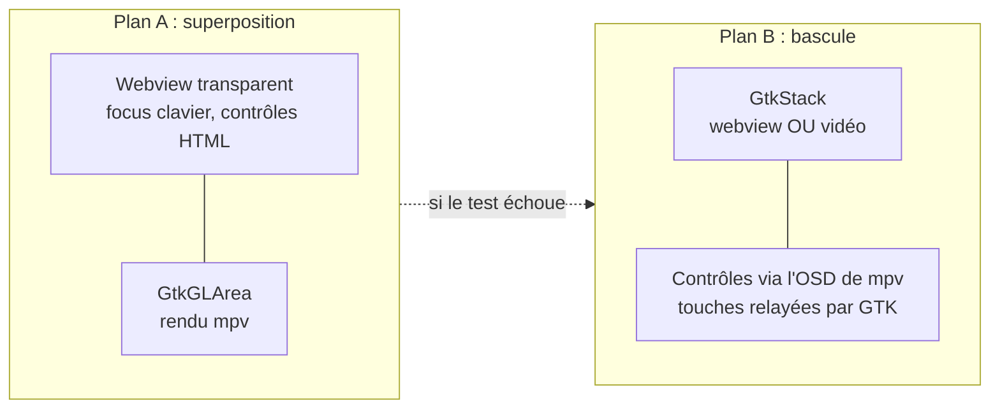

**Plan A, retenu si le test passe.** La racine de composition retire le webview du `default_vbox()` de la fenêtre et construit `GtkOverlay { GtkGLArea, WebView transparent }`. Ces API existent bien (`default_vbox`, `gtk_window`, `with_webview`), et le rendu mpv dans une `GtkGLArea` est une approche établie. En revanche, **je n'ai trouvé aucune source confirmant un WebKitGTK transparent par-dessus une `GtkGLArea`** : c'est une hypothèse.

**Plan B, solution de repli.** Même `GtkGLArea`, mais un `GtkStack` affiche soit l'interface soit la vidéo. Pendant la lecture, le clavier est relayé par GTK et les informations passent par l'OSD de mpv. Le résultat est moins riche et moins accessible, mais ne dépend d'aucune composition. La télécommande reste entièrement fonctionnelle, et le code de rendu est réutilisé.

**Test de validation, à faire avant tout le reste** (une à deux journées) sur Wayland et X11, Intel/AMD et NVIDIA :

| Critère | Seuil |
|---|---|
| Contrôles HTML visibles et transparents sur une vidéo 1080p | Sans artefact |
| Focus clavier conservé dans le webview pendant la lecture | Oui |
| Images perdues avec l'overlay visible (`estimated-frame-number`, `frame-drop-count`) | < 1 % |
| Charge CPU avec décodage matériel, overlay visible | Mesurée, comparée au plan B |
| Basculer plein écran et revenir, dix fois | Sans plantage ni fuite GL |

Le résultat donne lieu à l'ADR-002. Tester aussi `WEBKIT_DISABLE_DMABUF_RENDERER=1` en cas d'écran noir sous NVIDIA.

### 5.3 Lecture depuis un partage SMB

On ne donne pas d'URL `smb://` à mpv : la prise en charge dépend de sa compilation, et les identifiants risqueraient de se retrouver dans les journaux. mpv lit `http://127.0.0.1:<port>/stream/<jeton>` :

- Passerelle axum dans `remote-api`, **sur un écouteur distinct, lié uniquement à la boucle locale**, jamais exposé sur le LAN.
- Jeton aléatoire à usage limité par session de lecture.
- Prise en charge de `Range`, indispensable au déplacement dans le fichier.

**Client SMB : la crate `smb` (Rust pur, asynchrone).** Elle est préférée à `pavao` pour une raison précise : [la documentation de `pavao`](https://docs.rs/pavao/latest/pavao/) indique que chaque opération de haut niveau tient un verrou global au processus, donc une requête lente bloque toutes les autres. Ici, un partage lent gèlerait la lecture en cours d'un autre partage et irait contre C6. `smb` évite aussi une dépendance système à `libsmbclient`.

Contrepartie : elle est plus jeune et moins documentée. Le test sur Samba sous Docker doit donc valider listage récursif, `read_at`, authentification NTLM et accès invité, ce dernier n'étant pas confirmé par sa documentation. En cas d'échec, `pavao` s'exécuterait dans un processus de travail dédié, ce qui confinerait son verrou. Le port `SourceProvider` limite le changement à `infra`.

## 6. Interface de salon

- **React 19 + TypeScript + Vite**, déjà en place. **Tailwind CSS 4** pour les styles des deux interfaces (voir [Styles](#styles-avec-tailwind)). TanStack Query pour le cache des données.
- **Navigation spatiale maison** (environ 200 lignes, testables). Elle déplace le **vrai focus DOM**, avec `tabindex` itinérant. Les bibliothèques à focus virtuel ne changent qu'un état React, alors qu'un lecteur d'écran suit le focus DOM.
- **Une seule source d'entrée.** Clavier et télécommande produisent le même événement `InputAction` (`up`, `down`, `left`, `right`, `ok`, `back`) :

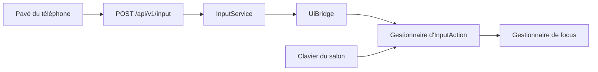

- **Thème indépendant du code.** `themes/default/theme.json`, validé par un JSON Schema publié, appliqué comme variables CSS que Tailwind consomme. Le chargement vérifie le contraste (4,5:1) et refuse un thème non conforme. Le second thème à chaud (bonus) devient trivial.
- **Accessibilité testée tôt.** HTML sémantique, régions `aria-live`, test Orca dès les premiers écrans, car WebKitGTK et AT-SPI sont un sujet de risque. Le sujet autorise la synthèse vocale intégrée : `speech-dispatcher` derrière un port `Announcer` en repli si Orca ne suit pas.
- **Garde-fou C1.** Une règle ESLint interdit `<video>`, `<audio>` et `new Audio()`.

### Styles avec Tailwind

Tailwind 4 s'intègre par `@tailwindcss/vite`, compatible avec Vite 8. Le sujet exige un thème « décrit dans un format documenté, indépendant du code de l'interface » : Tailwind ne doit donc pas devenir la source des couleurs. La chaîne est à sens unique :

```text
theme.json  →  variables CSS à l'exécution (--om-*)  →  @theme inline  →  classes (bg-surface, text-content)
```

```css
/* ui/shared/src/theme.css, importée par ui/tv et ui/remote */
@import "tailwindcss";
@source "../src";

@theme inline {
  --color-*: initial; /* retire la palette par défaut */
  --color-surface: var(--om-color-surface);
  --color-content: var(--om-color-content);
  --color-accent: var(--om-color-accent);
  --color-focus: var(--om-color-focus);
}
```

Règles à appliquer :

| Règle | Raison |
|---|---|
| Uniquement des couleurs sémantiques : la palette par défaut de Tailwind est désactivée par `--color-*: initial` dans `@theme` | Une classe `bg-blue-500` contournerait le thème et son contrôle de contraste |
| Sur la télé, l'indicateur de focus utilise `focus:` et non `focus-visible:` | Le focus déplacé par script depuis la télécommande n'active pas forcément `focus-visible`, or il doit toujours être très visible |
| Tailles de la télé définies dans une échelle propre (`--text-*`, `--spacing`), réglée pour 3 mètres | L'échelle par défaut de Tailwind vise un écran proche |
| Variantes de composants dans `ui/shared`, pas de classes construites par concaténation (`bg-${x}`) | Tailwind ne détecte que les noms de classes écrits en entier |
| `prettier-plugin-tailwindcss` et `eslint-plugin-better-tailwindcss` en CI | Ordre des classes stable, classes inconnues signalées |

**Navigateurs.** Tailwind 4 [exige Safari 16.4 et Chrome 111 au minimum](https://tailwindcss.com/docs/compatibility). La télécommande devient donc incompatible avec les iPhone restés sous une version antérieure d'iOS. Ce minimum doit figurer dans la documentation de la télécommande et la déclaration d'accessibilité. Côté télé, le risque est faible : la machine de développement sous Ubuntu 24.04 a WebKitGTK 2.52.6, une version récente. Le rendu reste à confirmer pendant le test vidéo (§5.2).

### Injection côté interface

La télé et le téléphone partagent des composants grâce à un fournisseur de client, équivalent de `State` côté TypeScript :

```tsx
// ui/shared : interface commune, types générés depuis Rust par ts-rs
export interface ApiClient {
  listMovies(query: MovieQuery): Promise<Page<MovieDto>>;
  subscribe(handler: (event: AppEvent) => void): () => void;
}

// ui/tv : <ApiProvider client={new TauriApiClient()}>
// ui/remote : <ApiProvider client={new HttpApiClient()}>
// tests : <ApiProvider client={fakeClient}>
```

Les erreurs ont un format commun, `{ code, message, field?, suggestion? }`. Les formulaires peuvent ainsi lier l'erreur au champ concerné et proposer une correction, comme l'exige le sujet.

## 7. Extensions

### Runtime : JavaScript dans un processus isolé

| Option | Isolation des permissions | Pour un développeur externe | Décision |
|---|---|---|---|
| Exécutable libre + JSON-RPC | Aucune : il ouvre ses propres sockets | Tout langage | Rejetée, viole C2 |
| Plugin natif (`.so`) | Aucune, dans le processus | Compilation | Rejetée, viole C2 et C3 |
| WebAssembly (`wasmtime`) | Excellente | Chaîne de compilation à installer | Solide, mais tutoriel plus lourd |
| **QuickJS (`rquickjs`) dans un processus dédié** | Aucune capacité par défaut | Un fichier `.js`, sans outil | **Retenue** |

QuickJS ne fournit ni système de fichiers ni réseau : le code d'une extension ne voit que ce que l'hôte lui expose. Cela rend le tutoriel « de zéro à une extension fonctionnelle » très court. Le mécanisme (manifeste, cycle de vie, API, courtier, permissions) est bien conçu par le groupe : QuickJS n'est que l'interpréteur.

### Trois lignes de défense

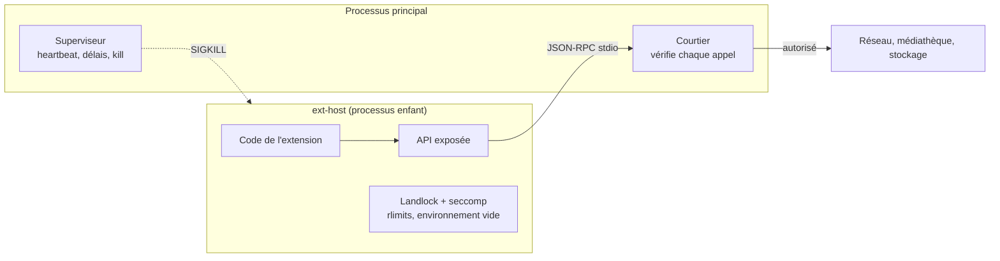

1. **Le langage** : pas de capacité ambiante dans QuickJS, limite mémoire, interruption des boucles infinies.
2. **Le courtier, seule autorité** : même une extension qui échapperait à l'API n'obtient rien, car tout accès réel s'exécute dans le processus principal après vérification. C'est aussi ce que testent les tests de permissions.
3. **Le système** : après initialisation et avant d'évaluer le code, `ext-host` applique `no_new_privs`, Landlock et un filtre seccomp interdisant la création de sockets, puis `RLIMIT_AS` et `PR_SET_PDEATHSIG`. C'est une défense en profondeur contre une faille de l'interpréteur. Si le noyau ne prend pas en charge Landlock, l'état est journalisé et les deux premières lignes restent actives.

**Contrôle de l'URL de lecture.** Une URL renvoyée par une extension source n'est transmise à mpv que si son schéma est `http(s)` et son domaine figure dans ses permissions. Sans cela, une extension pourrait faire lire à mpv une adresse interne ou `file://`.

### Paquet et manifeste

Une extension est une archive `.omx` (zip) contenant `manifest.json`, `main.js`, et éventuellement une icône :

```json
{
  "id": "org.example.public-domain-films",
  "name": "Films du domaine public",
  "version": "1.0.0",
  "apiVersion": 1,
  "author": "Exemple",
  "description": "Catalogue de films libres de droits",
  "type": "source",
  "main": "main.js",
  "permissions": {
    "network": ["archive.org"],
    "sources.provide": true
  }
}
```

```js
// main.js
export function activate(host) {
  host.sources.register({
    id: "catalogue",
    name: "Domaine public",
    async *enumerate() { /* produit des entrées avec leurs métadonnées */ },
    async locate(entryId) { return { url: "https://archive.org/..." }; },
  });
}
```

| Permission | Accorde | API |
|---|---|---|
| `network: [domaines]` | Requêtes HTTPS vers ces domaines uniquement | `host.fetch` |
| `library.read` | Lecture du catalogue | `host.library.*` |
| `sources.provide` | Ajout d'une source de médias | `host.sources.register` |
| `home.widget` | Élément sur l'écran d'accueil | `host.home.registerWidget` |
| `storage` | Clé-valeur propre à l'extension, avec quota | `host.storage.*` |

**Les widgets sont déclaratifs.** Une extension renvoie du JSON (`{ type: "stat", label, value, icon }`) et le produit en assure le rendu avec ses propres composants. Une extension n'injecte jamais de HTML ni de JS dans le webview : cela contournerait toute l'isolation, et l'accessibilité ne serait plus garantie.

### Cycle de vie

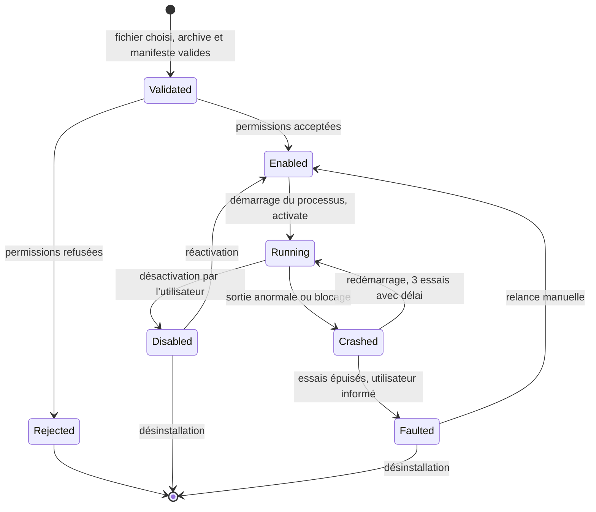

- **Installation sans redémarrage** : extraction dans un dossier temporaire (avec protection contre le *zip slip* et limite de taille décompressée), validation, consentement, déplacement atomique dans `$XDG_DATA_HOME/open-mosaik/extensions/<id>/<version>/`, lancement à chaud.
- **Mise à jour** : toute permission nouvelle exige un nouveau consentement.
- **Supervision** : heartbeat toutes les 5 s, délai de 10 s par appel, taille maximale de message, journal `stderr` plafonné. En cas de dépassement : `SIGKILL`, notification à l'écran, et les médias de cette source apparaissent indisponibles sans être supprimés.
- **Empaquetage de l'hôte** : `ext-host` est un binaire séparé (`bundle.externalBin`), sans lien avec GTK ni WebKit.

### Livrés dans `extensions/`

- `public-domain-films` : source, catalogue Internet Archive.
- `weather-widget` : widget d'accueil, Open-Meteo, permission réseau limitée à un domaine.
- `fixtures/` : extensions hostiles pour les tests (plantage, boucle infinie, saturation mémoire, accès à un domaine non déclaré, URL `file://`).

## 8. API de contrôle et télécommande

### Écoute et transport

Serveur axum piloté par `RemoteServerService`. L'adresse d'écoute se règle dans les paramètres (`0.0.0.0:8420` par défaut) et peut changer à chaud (§9). Si le port est occupé, le serveur **ne choisit pas un autre port en silence**, car le réglage de l'utilisateur serait faux et son QR code imprévisible : l'application démarre quand même, et un message renvoie vers le réglage en proposant un port libre. La page React est embarquée via `rust-embed`.

**HTTP sans TLS, décision à connaître.** Un certificat auto-signé déclenche un avertissement bloquant à l'ouverture depuis le QR code et peut gêner les WebSockets sur mobile. Sans autorité reconnue sur un LAN, le choix retenu est HTTP, avec un cookie de session. **Limite assumée et à documenter :** un attaquant déjà présent sur le même réseau et capable d'écouter le trafic pourrait capter un jeton. Le sujet exige des échanges authentifiés, pas chiffrés. Cette limite figure dans l'ADR-006 et la documentation de sécurité.

Autre conséquence : la page n'est pas un contexte sécurisé. `crypto.subtle`, le Service Worker et l'API Presse-papiers n'y sont pas disponibles. La télécommande ne doit pas en dépendre.

### Appairage

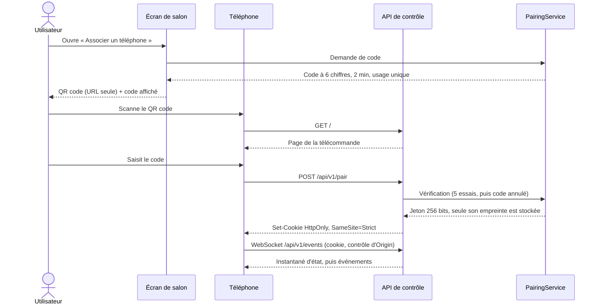

Le code n'est **pas** dans le QR code : celui-ci ne donne que l'URL, et la preuve de présence reste la lecture de l'écran. Un écran de réglages liste les appareils et permet de les révoquer. Le cookie convient aussi au WebSocket, car un navigateur ne peut pas y ajouter d'en-tête `Authorization`.

Toutes les routes sauf `GET /` et `POST /pair` exigent l'extracteur `PairedDevice`. Les requêtes modifiantes et le WebSocket vérifient `Origin`, et toutes les requêtes vérifient `Host`, contre le CSRF et le *DNS rebinding*. La liste des valeurs acceptées suit la configuration courante : interfaces locales et adresse publiée.

L'API de contrôle **n'expose aucune route de paramètres** (§9).

### Surface d'API (v1)

| Méthode et route | Rôle |
|---|---|
| `POST /api/v1/pair` | Échange du code contre une session |
| `POST /api/v1/input` | `up`, `down`, `left`, `right`, `ok`, `back` |
| `GET /api/v1/player` | État courant |
| `POST /api/v1/player/{play,pause,seek,volume,stop}` | Commandes de lecture |
| `POST /api/v1/player/load` | Lancer un média à l'écran |
| `GET /api/v1/movies`, `/series`, `/series/{id}`, `/albums`, `/albums/{id}` | Parcours |
| `GET /api/v1/search?q=` | Recherche |
| `GET /api/v1/artwork/{id}` | Images |
| `WS /api/v1/events` | `player.state`, `library.changed`, `source.health`, `extension.status` |

**Temps réel.** À chaque connexion ou reconnexion, le serveur envoie d'abord un instantané complet, puis les changements, limités à environ 1 par seconde pour la progression. Le client n'a rien à recoller après une coupure Wi-Fi ou une mise en veille du téléphone, situation courante sur iOS.

### Flux : lancer un film depuis le téléphone

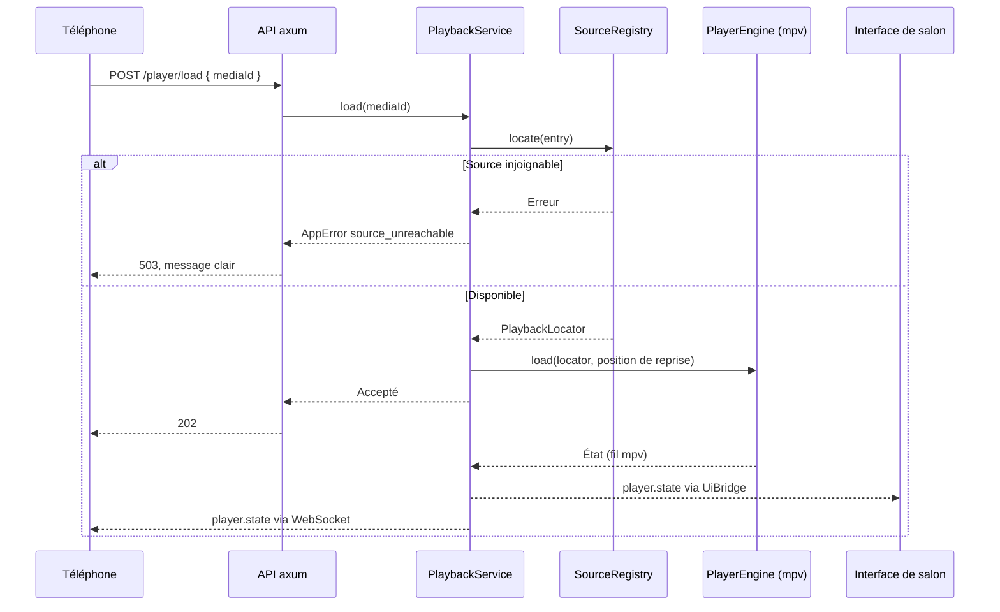

L'interface de salon et le téléphone sont de simples abonnés au même état. Une action lancée depuis l'un se répercute sur l'autre sans code particulier.

## 9. Configuration

Tout réglage utile à l'utilisateur se modifie depuis l'écran **Paramètres**, sans fichier à éditer et sans redémarrage. Les seuils et durées cités ailleurs dans ce document sont des **valeurs par défaut**.

### Où vit chaque réglage

| Nature | Stockage | Écran | Exemple |
|---|---|---|---|
| Réglage simple | Table `setting`, validé par `SettingsService` | Généré depuis les descripteurs | Seuil « vu » |
| Secret | Trousseau via `SecretStore` | Champ en écriture seule | Clé TMDB, mot de passe SMB |
| Collection | Ses propres tables et son service | Écran dédié | Sources, appareils, extensions |
| Amorçage | Variable d'environnement ou argument | Aucun, affiché en lecture seule | Répertoire de données |

**Ordre de priorité :** variable d'environnement, puis valeur enregistrée, puis valeur par défaut. Les variables servent au développement et à la CI, et sont documentées dans `.env.example`. Un réglage imposé par l'environnement apparaît verrouillé dans l'écran, avec la raison affichée.

### Catalogue

| Section | Réglages |
|---|---|
| **Sources** | Dossiers locaux et partages SMB : ajouter, **tester la connexion**, modifier, supprimer, relancer un scan. Pour un partage : hôte, port, partage, chemin, domaine, utilisateur, mot de passe ou accès invité |
| **Télécommande** | Activée ou non, adresse d'écoute (`host`), `port`, adresse publiée dans le QR code, durée des sessions, durée et essais du code, appareils appairés et révocation |
| **Métadonnées** | Clé TMDB avec **test de la clé**, langue et région, contact MusicBrainz pour le `User-Agent`, fournisseurs actifs, seuil de confiance, mode hors ligne |
| **Médiathèque** | Scan au démarrage, intervalle du scan périodique, durée de grâce avant purge, délai réseau, parallélisme |
| **Lecture** | Langues audio et sous-titres préférées, reprise automatique, seuil « vu », épisode suivant et compte à rebours, volume initial, sortie audio, décodage matériel, taille du tampon réseau |
| **Interface** | Thème, langue, taille du texte, synthèse vocale, animations réduites |
| **Extensions** | Activer ou désactiver, voir et **retirer une permission**, limites de mémoire et de délai, essais de redémarrage |
| **Système** | Niveau de journalisation, emplacement des données (lecture seule), réinitialisation par section, attributions |

Un **assistant au premier lancement** présente les trois réglages qui comptent : ajouter une source, saisir une clé TMDB (facultatif), vérifier l'adresse de la télécommande. Il réutilise les mêmes formulaires et peut être passé.

### Réglages typés et diffusion à chaud

```rust
// crates/core/src/settings/service.rs
#[derive(Clone)]
pub struct SettingsService {
    repo: Arc<dyn SettingsRepository>,
    secrets: Arc<dyn SecretStore>,
    current: Arc<watch::Sender<Arc<Settings>>>,
}

impl SettingsService {
    pub async fn update(&self, patch: SettingsPatch) -> Result<Arc<Settings>, AppError>; // valide, persiste, diffuse
    pub fn view(&self) -> SettingsView; // lecture seule, pour l'injection
}
```

- **Injection d'une vue.** Les autres services reçoivent un `SettingsView` et ne peuvent donc ni écrire ni former de cycle. Ils lisent la valeur au moment de s'en servir, ou s'abonnent s'ils doivent réagir. En test, `SettingsView::fixed(settings)` suffit.
- **Écran généré.** Chaque réglage simple possède un descripteur `{ clé, type, défaut, bornes, unité, moment d'application }`, exporté en TypeScript par `ts-rs`. Ajouter un réglage ne demande pas d'écrire un formulaire. Les bornes sont vérifiées **côté Rust** : l'interface ne fait qu'en afficher le résultat.
- **Migrations.** Une valeur enregistrée invalide après une mise à jour revient à sa valeur par défaut, avec un message, et n'empêche jamais le démarrage.

| Moment d'application | Réglages |
|---|---|
| Immédiat | Thème, langue, seuils, clé TMDB, journalisation |
| Prochaine opération | Délai réseau, parallélisme : prochain scan |
| Prochaine lecture | Décodage matériel, tampon réseau, sortie audio |
| Avec vérification et retour arrière | Adresse d'écoute de la télécommande (ci-dessous) |

### Changer l'adresse de la télécommande

Ce réglage ne passe pas par `update()` : un `bind` peut échouer, et il ne faut enregistrer que ce qui fonctionne.

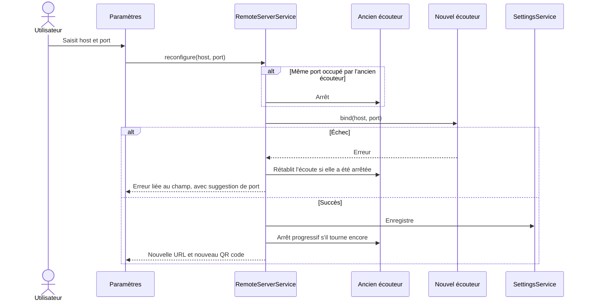

Conséquences affichées avant de confirmer :

- Les téléphones connectés sont déconnectés. Ils doivent rescanner le QR code, et ils devront s'appairer à nouveau si l'hôte change, car le cookie est lié à l'hôte.
- `127.0.0.1` est accepté, avec l'avertissement que le téléphone ne pourra plus se connecter.
- L'**adresse publiée** est distincte de l'adresse d'écoute. Avec `0.0.0.0`, le produit propose les interfaces détectées, car une machine peut en avoir plusieurs et le QR code doit donner celle que le téléphone peut joindre.

### Secrets

- **Écriture seule.** L'interface ne reçoit que `{ configured: true }`. Une valeur enregistrée n'est jamais renvoyée, même à la télé : on la remplace ou on l'efface.
- **Sans trousseau,** l'enregistrement échoue avec un message explicite, comme pour les identifiants SMB (§4). Sur une machine sans Secret Service, `OPEN_MOSAIK_TMDB_API_KEY` reste possible, et le réglage apparaît alors verrouillé.
- **Test avant enregistrement.** `MetadataProvider::check` valide la clé TMDB et `SourceProvider::health` valide un partage. Un test sans réseau est signalé comme « non vérifié » et n'empêche pas d'enregistrer, puisque le produit doit rester utilisable hors ligne.

### Accès depuis le téléphone

La v1 n'expose pas les paramètres dans l'API de contrôle. Les échanges avec le téléphone ne sont pas chiffrés (§8) : y envoyer une clé ou un mot de passe SMB les ferait passer en clair sur le réseau. Un téléphone appairé peut néanmoins parcourir l'écran Paramètres de la télé avec le pavé directionnel. C'est une raison de plus pour que les secrets soient en écriture seule.

### Saisie sans clavier

L'interface se pilote aux flèches : saisir une clé TMDB ou une adresse exige donc un **clavier virtuel** dans `ui/tv`, accessible, avec des dispositions lettres, chiffres et symboles. Un clavier physique reste utilisable à tout moment.

### Ce qui reste volontairement non configurable

Ce sont des garanties de sécurité : les rendre réglables reviendrait à les supprimer.

| Invariant | Raison |
|---|---|
| Passerelle de flux liée à la boucle locale | Elle ne doit jamais être exposée au LAN |
| Appairage obligatoire | Exigence du sujet |
| Contrôle des permissions, bac à sable des extensions | Exigence du sujet |
| Configuration fermée de mpv | Empêche d'exécuter des scripts tiers |

Les réglages sensibles restent bornés : par exemple, le code d'appairage garde au moins 6 chiffres et un maximum de 10 essais, et les limites d'une extension ont un plafond.

## 10. Modèle de données

SQLite via `sqlx`, migrations versionnées, mode WAL, recherche FTS5. La séparation clé est celle entre **le fichier** (`media_file`, ce qui existe sur une source) et **l'œuvre** (`movie`, `episode`, `track`, ce qui est reconnu). Elle permet de corriger une reconnaissance sans toucher au fichier.

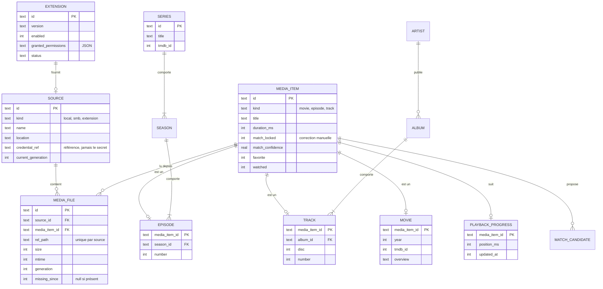

Autres tables : `artwork`, `person`/`credit` (casting), `genre`, `season`, `artist`, `album`, `match_candidate`, `enrichment_job`, `paired_device` (empreinte de jeton, `last_seen`), `setting`, `media_fts` (FTS5). Le dictionnaire complet des champs ira dans `docs/technique/modele-de-donnees.md`.

## 11. Choix de stack

Versions constatées sur crates.io en novembre 2026. Elles seront fixées par `Cargo.lock` et `pnpm-lock.yaml`.

| Domaine | Choix | Justification | Écartés |
|---|---|---|---|
| Application | Tauri 2.12 | Demandé. Binaire léger, accès GTK natif pour composer la vidéo. | Electron : pas d'accès natif équivalent pour la vidéo, poids |
| Moteur | libmpv, `libmpv2` 7.x | API de rendu embarquable, formats et pistes couverts | GStreamer : plus d'assemblage ; VLC : intégration Linux moins directe |
| Interface | React 19, Vite | Déjà en place, composants partagés télé/téléphone | |
| Styles | Tailwind CSS 4 | Demandé. CSS statique sans moteur à l'exécution, compatible avec une CSP stricte ; les variables CSS gardent le thème indépendant du code | Tailwind 3 : seulement utile pour des navigateurs anciens, non requis ici |
| API | axum 0.8 | Tokio, WebSocket, extracteur `State` analogue à celui de Tauri | Serveur intégré à Tauri : inexistant pour le LAN |
| Base | SQLite, `sqlx` 0.9 | Un fichier, FTS5, migrations | ORM : inutile pour ce schéma |
| SMB | `smb` 0.12 | Rust pur, asynchrone, sans verrou global | `pavao` : verrou global (§5.3) |
| Tags audio | `lofty` | Rust pur, multi-format | |
| Extensions | `rquickjs`, `landlock`, seccomp | Voir §7 | WebAssembly |
| Secrets | `keyring` | Secret Service, standard Linux | Fichier chiffré : où mettre la clé ? |
| Types partagés | `ts-rs` | Un seul contrat pour IPC et HTTP | Écriture manuelle : dérive garantie |
| Paquet | `.deb`, AppImage | Produits par le bundler Tauri. Le `.deb` déclare `libmpv2` en dépendance. | Flatpak : le bac à sable complique libmpv et les sous-processus |

**Plateforme de référence :** Ubuntu 24.04. C'est sur elle que la CI compile et que la démonstration se déroule.

## 12. Sécurité

| Menace | Parade |
|---|---|
| Téléphone non autorisé | Appairage, jeton 256 bits, empreinte seule stockée, révocation |
| Force brute sur le code | 6 chiffres, 2 minutes, usage unique, 5 essais |
| Site web malveillant visant le LAN | `SameSite=Strict`, contrôle d'`Origin` |
| Écoute passive du LAN | **Non couverte par le chiffrement** : limite documentée (§8) |
| Extension malveillante | Trois lignes de défense (§7) |
| Archive piégée | Protection contre *zip slip* et bombes de décompression |
| XSS via métadonnées externes ou d'extension | Rendu React échappé, widgets déclaratifs, CSP stricte |
| Accès direct à la passerelle de flux | Boucle locale uniquement, jeton par session |
| Fuite de secrets | Trousseau, champs en écriture seule, `.env` ignoré par git, secrets GitHub, aucun secret dans les journaux |
| Réglage modifié pour affaiblir le produit | Invariants non configurables, bornes vérifiées côté Rust (§9) |
| Webview détourné | Capacités Tauri minimales, seules nos commandes exposées, aucun plugin `fs` ni `shell` |

## 13. Tests et CI

`pnpm test` lance tout, Rust et TypeScript, sans réseau.

| Exigence du sujet | Niveau | Comment |
|---|---|---|
| Reconnaissance des noms de fichiers | Unitaire | Corpus en table, avec les noms difficiles de la démo |
| Scan incrémental | Service | Faux `SourceProvider` : ajout, modification, suppression, panne en plein parcours |
| Reprise de lecture | Service | `PlayerEngine` scripté + `Clock` manuelle |
| Cycle de vie et permissions des extensions | Intégration | Vrais processus `ext-host`, fixtures hostiles |
| API de contrôle et appairage | Intégration | Routeur axum avec `tower::oneshot`, sans port ouvert |
| API externes | Unitaire | Réponses enregistrées, aucun appel réel |
| Télécommande | Composant + E2E | Vitest + Testing Library + axe ; Playwright (Safari mobile et Chrome émulés) contre une API factice |
| SMB réel | Intégration, CI | Samba sous Docker, panne simulée en arrêtant le conteneur |
| Réglages | Service | Bornes, priorité environnement/base/défaut, valeur invalide après migration, secrets jamais renvoyés |
| Changement d'adresse à chaud | Intégration | Vrais sockets : port occupé, retour arrière, ancien écouteur fermé |

La force de la structure en crates apparaît ici : `core` et `remote-api` se testent sans GTK, WebKit ni libmpv.

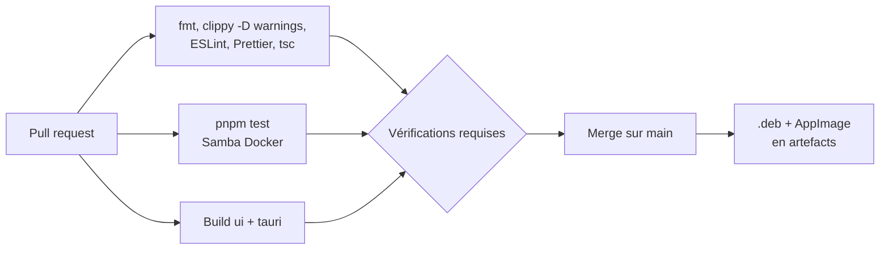

La branche `main` est protégée et ces vérifications sont requises. Les pipelines construisent `ui/remote` avant la compilation Rust, car `rust-embed` l'embarque. Un hook pre-commit lance le formatage et le lint, et les messages de commit suivent Conventional Commits.

## 14. Trajectoire par jalon

| Jalon | Priorités d'architecture |
|---|---|
| **Suivi 1** (début novembre) | Restructuration en workspace, DI et un service bout en bout, **test vidéo §5.2**, test SMB, ADR-001 à 006, CI |
| **Suivi 2** (début décembre) | `SettingsService` et clavier virtuel, écrans Sources et Métadonnées, scan, reconnaissance, enrichissement, lecture avec reprise, `.deb` produit par la CI |
| **Suivi 3** (début janvier) | API, appairage, télécommande et son changement d'adresse à chaud, système d'extensions et bac à sable, charte graphique |
| **Suivi 4** (début février) | Deux extensions, thème, audit d'accessibilité, documentation complète, gel fonctionnel |
| **Soutenance** (mi-février) | Répétition en conditions : réseau réel, partage de connexion de secours, installation d'extension en direct, parcours Orca |

Le suivi 1 tombe maintenant : le test vidéo et le test SMB sont à lancer immédiatement, car leurs résultats peuvent changer deux ADR.

### ADR à rédiger dans `docs/adr/`

| ADR | Décision |
|---|---|
| 001 | Tauri et séparation en crates |
| 002 | Composition vidéo : superposition ou bascule, selon le test |
| 003 | DI par constructeur, services clonables, `State` en frontière |
| 004 | Client SMB et passerelle de flux locale |
| 005 | Extensions : QuickJS, processus séparé, courtier |
| 006 | HTTP sans TLS sur le LAN, avec limite documentée |
| 007 | Widgets déclaratifs |
| 008 | Configuration à chaud, secrets en écriture seule, invariants non configurables |

## 15. Écarts avec le scaffold actuel

| Fichier | Actuel | À faire |
|---|---|---|
| `src-tauri/Cargo.toml` | `panic = "abort"` en release | **Retirer** : une panique dans une tâche de fond tuerait le media center, au lieu de rester confinée à cette tâche |
| `src-tauri/tauri.conf.json` | `csp: null` | CSP stricte, sans `unsafe-inline` pour les scripts |
| `src-tauri/tauri.conf.json` | Fenêtre 800×600 créée automatiquement | `create: false`, création dans `setup`, plein écran, sans décoration |
| `src-tauri/src/lib.rs` | `UserService` et `greet` d'essai | À supprimer au profit de `bootstrap.rs` |
| `tauri-plugin-opener` | Présent | À retirer si inutile, conformément au principe de capacités minimales |
| `src/` | Application modèle | Déplacer vers `ui/tv`, `pnpm-workspace.yaml` |

## 16. Niveau de certitude

**Vérifié dans la documentation ou le registre :** contraintes de `State` et `Result` pour les commandes asynchrones ; existence de `default_vbox`, `gtk_window` et `PlatformWebview::inner` ; absence de prise en charge de l'embarquement Linux par `tauri-plugin-libmpv` ; verrou global de `pavao` ; lecture par `read_at` de `smb` ; exigence `LC_NUMERIC=C`, ordre de création et risque d'interblocage du rendu mpv ; versions des crates.

**Hypothèses à valider par un test :**

- WebKitGTK transparent au-dessus d'une `GtkGLArea` (§5.2).
- Listage récursif, NTLM et accès invité avec la crate `smb` (§5.3).
- Orca sur l'interface WebKitGTK (§6).
- Compatibilité de QuickJS avec seccomp et Landlock après initialisation (§7).
- Inclusion de libmpv et de ses dépendances dans l'AppImage (§11).
- Disponibilité du Secret Service sur la machine de salon, surtout avec une connexion automatique sans déverrouillage du trousseau (§9).

**Décisions à confirmer par le binôme :**

- **Nom du produit :** « Open Mosaik » est repris du scaffold (`open-mosaik`). Vérifier qu'il n'imite aucune marque avant de produire la charte.
- **HTTP sans TLS sur le LAN :** c'est la décision de sécurité la plus discutable, à défendre en soutenance (ADR-006).
