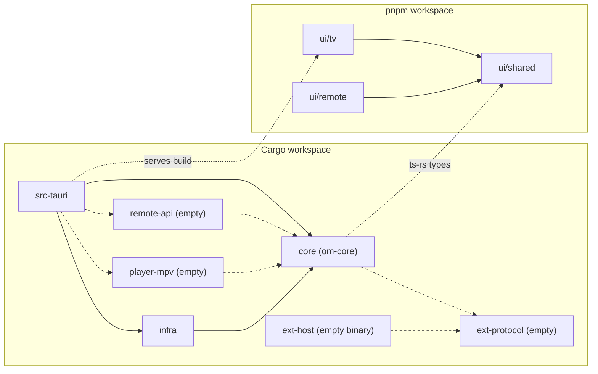
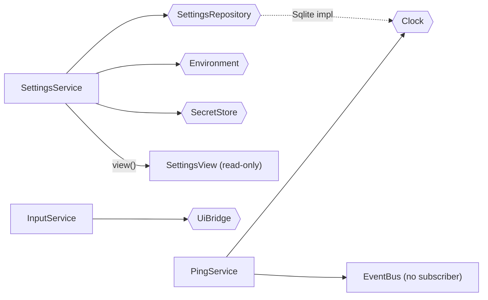
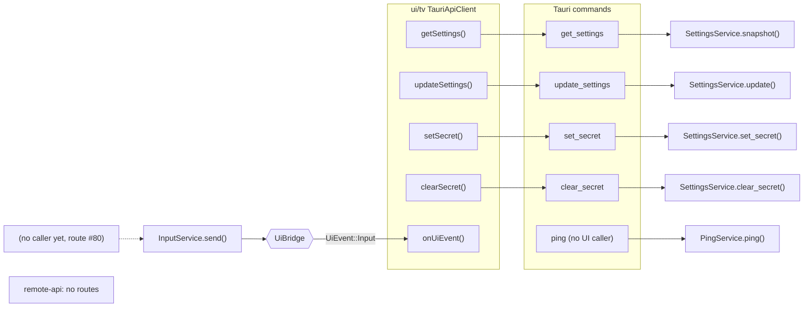
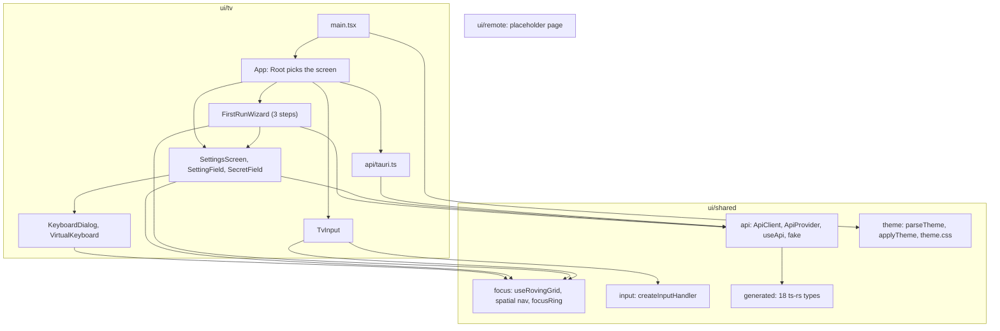

# Code architecture

/code-diagram · 2026-11-26 · feat/epic-04-4-input-action @ 820619a + uncommitted #30 work

## Crates

Dashed: declared but unused (cargo `unused_dependencies` warning). No arrow breaks the expected direction.

## Services and ports

| Port | Real | Fake |
|---|---|---|
| `SettingsRepository` | `SqliteSettingsRepository` (infra), in-memory SQLite fallback | `MemorySettingsRepository` |
| `Environment` | `ProcessEnvironment` (infra) | `MemoryEnvironment` |
| `SecretStore` | `KeyringSecretStore` (infra) | `MemorySecretStore` |
| `Clock` | `SystemClock` (infra) | `ManualClock` |
| `UiBridge` | `TauriUiBridge` (src-tauri, event `ui-event`) | `RecordingUiBridge` |

## Boundary

## Frontend

## Gaps vs ARCHITECTURE.md

- Missing services (§3): Source, Scan, Library, Metadata, Playback, Extension, Pairing, RemoteServer.
- Undocumented service: `PingService` (wiring example) and its `ping` command.
- Missing ports (§3): Media/Source/Progress/Device/Extension repositories, `SourceProvider`, `MetadataProvider`, `ArtworkStore`, `PlayerEngine`, `ExtensionRuntime`.
- Undocumented port: `Environment`.
- Control API (§8): no route, no `PairedDevice`, no WebSocket, no stream gateway.
- UI (§6): no `HttpApiClient` (#31), no TanStack Query.
