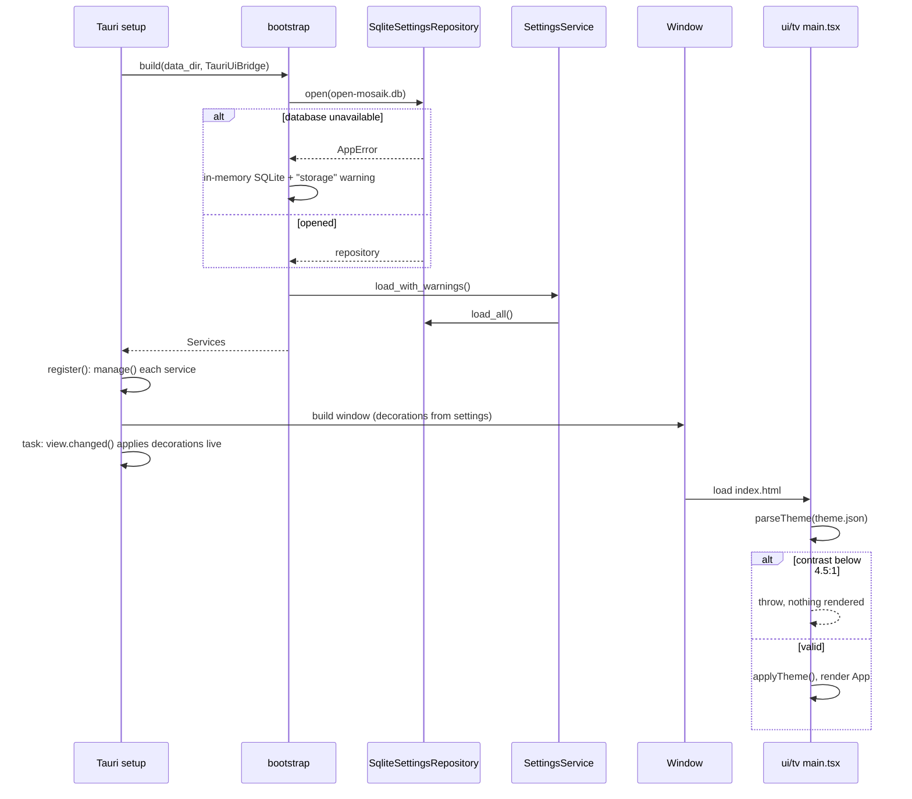
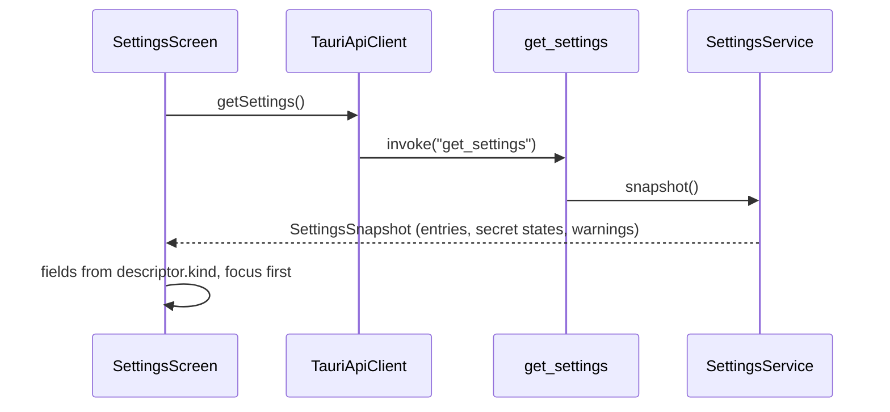
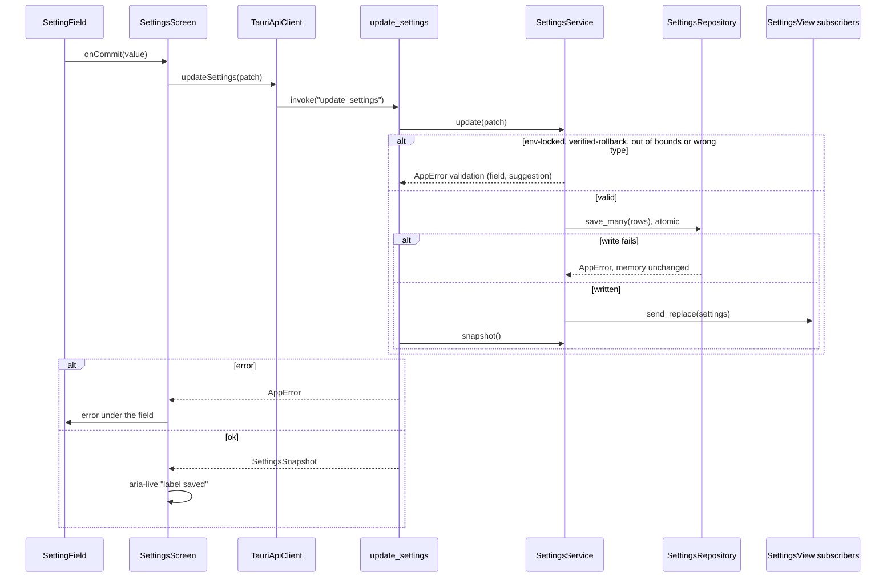
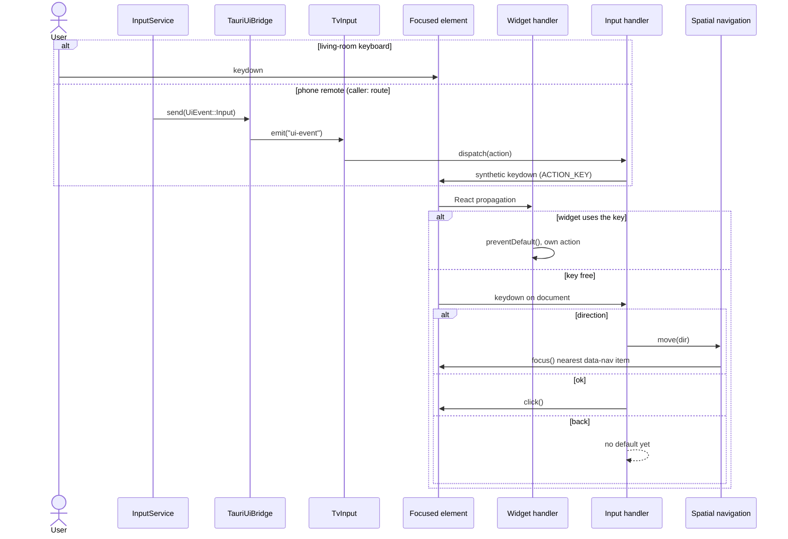

# Main flows

/code-diagram · 2026-11-26 · feat/epic-04-4-input-action @ 820619a + uncommitted #30 work

## Startup

Files: src-tauri/src/lib.rs:15, src-tauri/src/bootstrap.rs:27, src-tauri/src/bootstrap.rs:87, ui/tv/src/main.tsx:10, ui/shared/src/theme/theme.ts:54

## Read settings

Files: ui/tv/src/settings/SettingsScreen.tsx:32, ui/tv/src/api/tauri.ts:10, src-tauri/src/commands/settings.rs:8

## Update a setting

Files: ui/tv/src/settings/SettingsScreen.tsx:41, src-tauri/src/commands/settings.rs:13, crates/core/src/settings/service.rs:311, crates/infra/src/settings_repository.rs:39

## Input: keyboard and UiBridge

Files: crates/core/src/input.rs:35, src-tauri/src/ui_bridge.rs:20, ui/tv/src/input/TvInput.tsx:16, ui/shared/src/input/inputHandler.ts:58, ui/shared/src/focus/spatialNavigation.ts:69

## Planned, not implemented

- Phone pairing, `POST /api/v1/pair`: ARCHITECTURE.md §8.
- Play a movie from the phone, `POST /player/load` → PlaybackService → PlayerEngine: §8.
- SMB playback through the local stream gateway: §5.3.
- Source scan and metadata (TMDB, MusicBrainz): §4, §5.
- Live state, `WS /api/v1/events`: §8.
