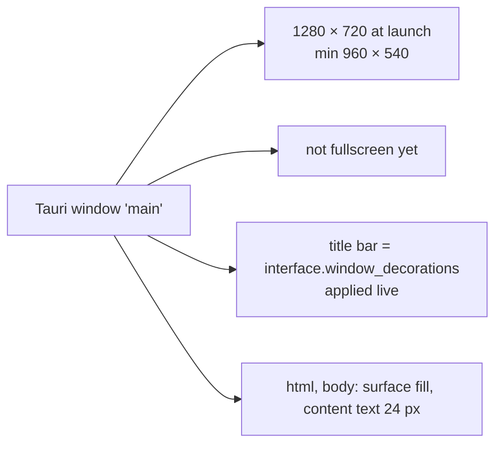
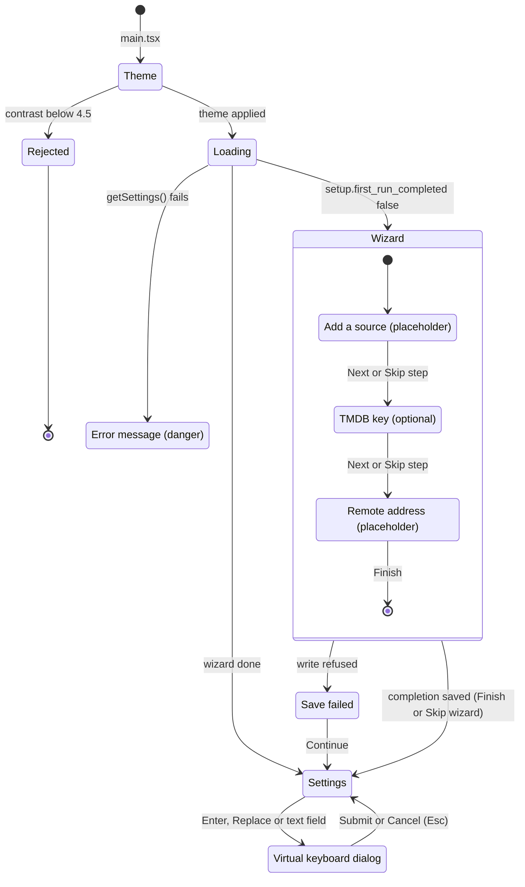
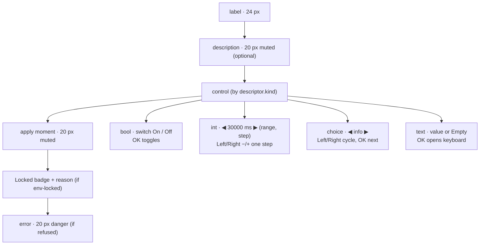
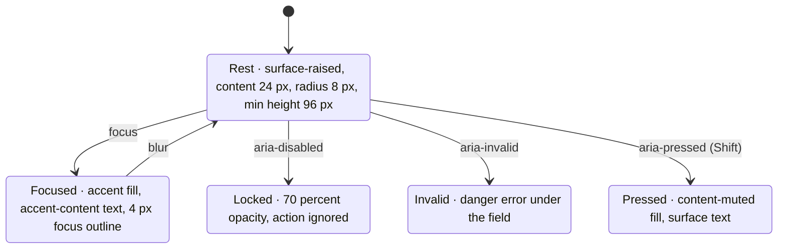
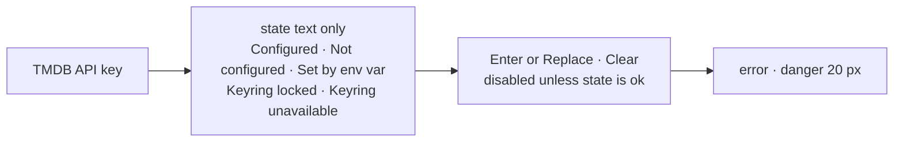
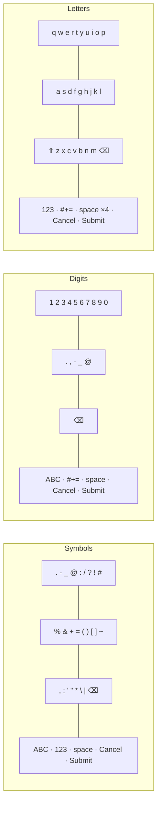
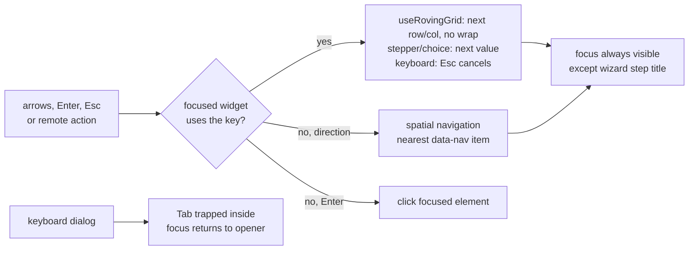

# TV UI details

/code-diagram · 2026-11-26 · feat/epic-04-4-input-action @ 820619a + uncommitted #30 work

Colors and sizes: [visual-identity.md](visual-identity.md). `ui/remote` only shows a placeholder page.

## Window

## Screen flow

## Layouts

```mermaid
flowchart TB
    subgraph settings["Settings · centered, max 1024 px, padding 48 px"]
        s1["h1 Settings · 48 px"]
        s2["warnings panel (if any) · surface-raised, danger 20 px"]
        s3["section per category · h2 32 px + bottom rule"]
        s4["fields"]
        s5["Secrets section · secret fields"]
        s6["hidden aria-live region"]
        s1 --> s2 --> s3 --> s4 --> s5 --> s6
    end
    subgraph wizard["Wizard · centered, max 896 px, padding 48 px"]
        w1["Step n of 3 · 20 px muted"]
        w2["h1 step title · 48 px, takes focus, no outline"]
        w3["step content"]
        w4["Skip step · Next / Finish"]
        w5["Skip wizard"]
        w1 --> w2 --> w3 --> w4 --> w5
    end
    subgraph dialog["Keyboard dialog · fullscreen overlay, surface, z-50"]
        k1["prompt · 32 px"]
        k2["input box · surface-raised, min 120 px, mono 32 px<br/>accent caret, dots for secrets"]
        k3["key grid · gap 18 px"]
        k1 --> k2 --> k3
    end
```

## Setting field

Apply moments shown: Applied immediately, Next operation, Next playback, After verification (French labels in the UI).

## Control and key states

## Secret field (write-only)

## Virtual keyboard

Keys are at least 96 × 96 px. Each keystroke is announced (only "character typed" for secrets); Shift stays pressed until the next character.

## Focus and navigation

