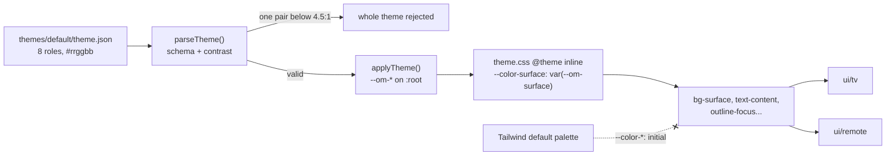
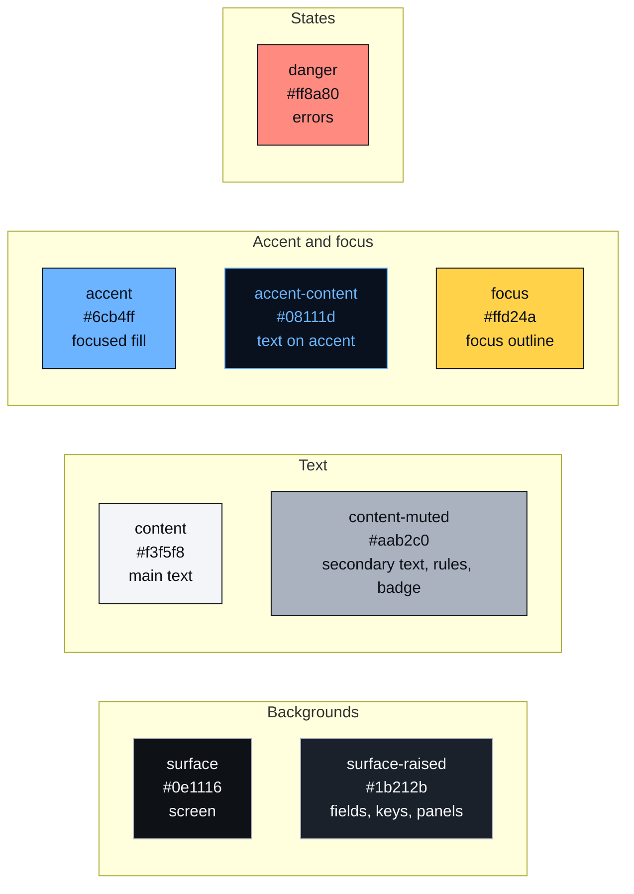
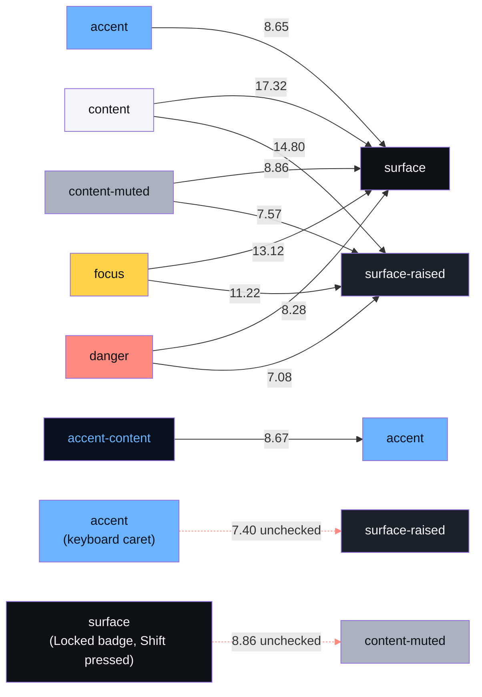
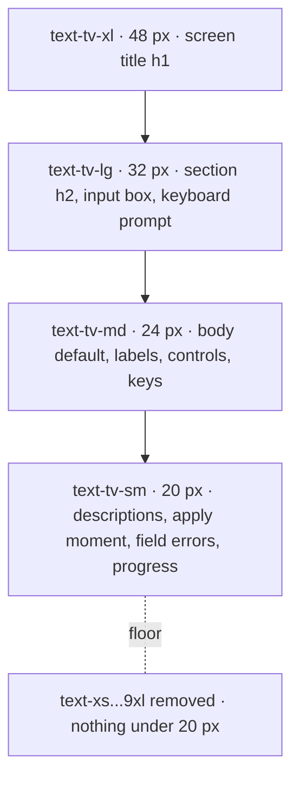
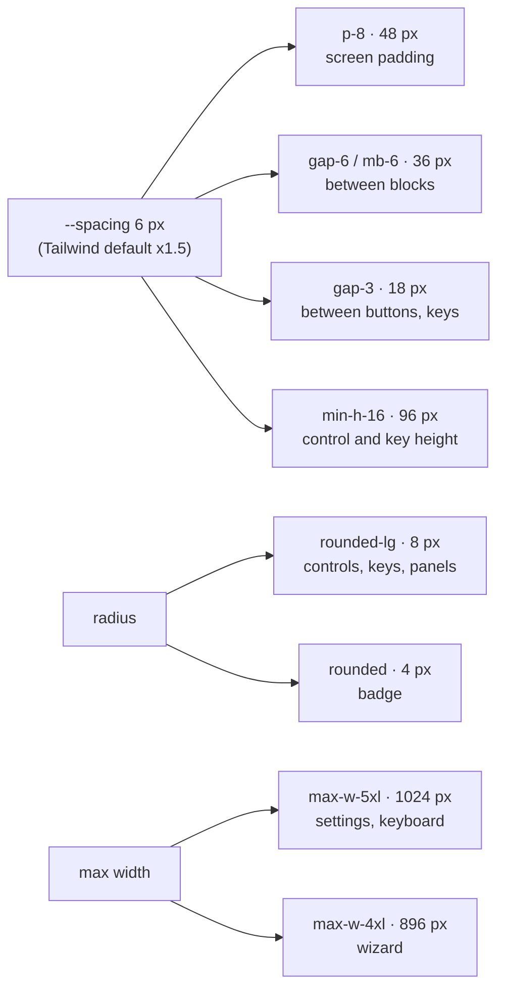
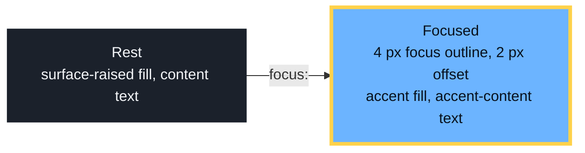
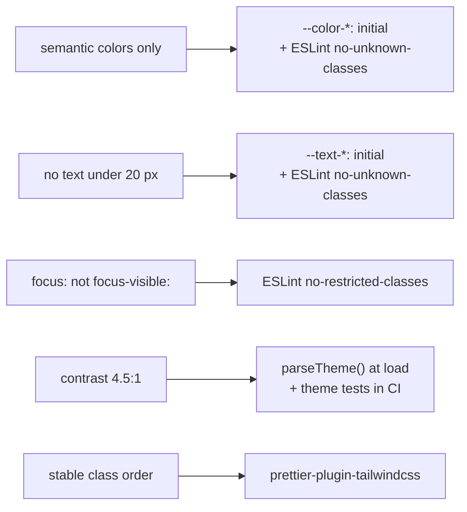

# Visual identity

/code-diagram · 2026-11-26 · feat/epic-04-4-input-action @ 820619a + uncommitted #30 work

## Theme pipeline

## Palette (default theme)

## Contrast (minimum 4.5:1)

Solid: `CONTRAST_PAIRS`, checked on every load. Red dashed: used by the UI but missing from `CONTRAST_PAIRS`, so another theme would not be checked on them.

## Type scale (TV)

Font: WebView default sans-serif; `font-mono` for the virtual keyboard input box.

## Spacing and shapes

## Focus indicator (`focusRing`)

`focus:`, never `focus-visible:`: focus moved by script or by the remote may not match `:focus-visible`.

## Enforcement

